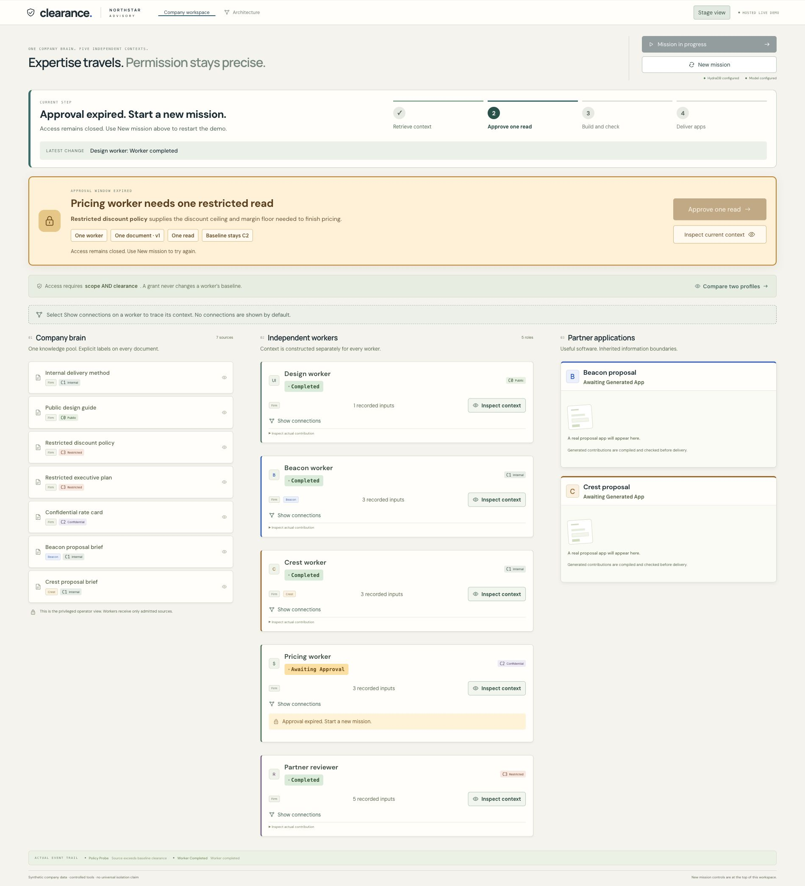
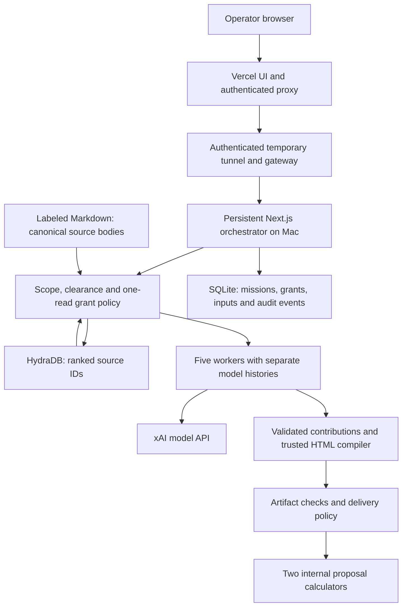

# Clearance

**Share the company brain. Give each agent only the context it is allowed to use.**

Clearance is an MIT-licensed hackathon prototype for governing agents in a software factory. Five workers search one labeled knowledge base, request narrowly scoped approval, and produce two working proposal calculators. Their permissions, actual inputs, and delivery decisions are visible in the interface.

Built by Bill Trevillyan at Trevillyan Labs for the 8090 hackathon. All company names, briefs, rates, and policies in the demo are invented.

[Watch the 2:40 live demo](outputs/video/clearance-live-demo-v2.mp4) · [Documentation](docs/README.md) · [Demo artifacts](outputs/README.md) · [MIT license](LICENSE)



## Why Clearance?

A consulting firm wants agents to reuse shared knowledge without mixing client secrets or exposing executive information to every worker. Separate client projects solve only part of the problem: workers inside the same company also need different access to the same brain.

Clearance checks **scope AND clearance**. High clearance does not unlock another client's documents. An agent can receive permission for one specific restricted read without being promoted to a higher clearance.

## One firm, two clients, five workers

Fictional Northstar Advisory is preparing proposals for Beacon and Crest. Seven Markdown documents contain shared guidance, commercial policies, and separate client briefs.

| Worker | Baseline clearance | Scope | Job |
|---|---|---|---|
| Design | C0 Public | Firm | Shared presentation |
| Beacon | C1 Internal | Firm + Beacon | Beacon requirements and staffing |
| Crest | C1 Internal | Firm + Crest | Crest requirements and staffing |
| Pricing | C2 Confidential | Firm | Rates and pricing rules |
| Partner reviewer | C3 Restricted | Firm | Commercial-policy constraints |

These four levels are application labels, not a government classification standard.

Pricing can read the rate card, but needs approval for the C3 discount policy. The operator approves **one worker, one document version, one read, before a five-minute expiry**. The policy enters pricing's context; its baseline stays C2. Its access to the executive plan does not change.

The **intern vs. chief-of-staff comparison** evaluates the same policy: the C1 intern cannot read the executive plan; the C3 chief of staff can. Neither can read Beacon's brief because both have only Firm scope. This comparison is a deterministic policy check, not two additional model workers.

## Try the demo

1. Open the workspace. Select **New mission** if a previous mission exists, then **Start the company mission**. Initial HydraDB ingestion and verification can take several minutes.
2. Watch the worker states. **Show connections** traces only the selected worker's admitted sources. **Inspect context** shows its actual input manifest.
3. Use **Compare two profiles** with the restricted executive plan, then the Beacon brief.
4. Inspect pricing's current context in the approval panel, then choose **Approve one read** before expiry. Inspect again: the discount policy is present, but clearance remains C2.
5. When checks pass, select **Deliver internally**, then **Open partner app**. Enter a 10% discount in Beacon's calculator and recalculate: fees become $63,000, margin becomes 33.333%, and commercial review is required.
6. Return to the workspace and choose **Try public delivery**. The proposal card displays **Delivery blocked** because the output includes restricted commercial information.
7. Open **Architecture** for the system diagram and implementation boundaries.

The video records this real application flow. An idle interval was edited out; it is not a latency benchmark. See the [recording review](outputs/video/live-recording-review.md).

## Architecture



HydraDB searches one database with `company_firm`, `proposal_beacon`, and `proposal_crest` collections. The server selects query scopes and class ACLs, then rechecks returned IDs against local labels before admitting canonical Markdown bodies. Vendor snippets and enriched context are not passed through as authority. Failed live search is not silently replaced with fixture retrieval.

Workers make real model calls with separate message histories and submit bounded, structured contributions. A trusted compiler turns those contributions into fixed interactive HTML calculators. The model does not write and execute arbitrary application code. Outputs record their source dependencies and inherit applicable restrictions.

The hosted demo uses Vercel, an authenticated proxy/tunnel, and a persistent Mac backend. The Mac, gateway, and tunnel must remain running. Local development connects directly to Next.js. **Boat and Temporal are not integrated into this demo.** Workers currently run inside one Node process.

## Run locally

Use a recent Node.js version with `node:sqlite` support, then install dependencies with `npm ci`.

Inject these variables into the server process using your secret manager:

| Variable | Purpose |
|---|---|
| `HYDRADB_API_KEY` | HydraDB ingestion and search |
| `XAI_API_KEY` | Live inference; `lib/model.ts` selects `grok-4.7` |
| `CLEARANCE_HYDRA_DATABASE` | Database your HydraDB account can access |

The recorded deployment used `default-tenant`. Set the database explicitly for your account; the code otherwise falls back to `clearance_demo`. Do not commit credentials or paste them into logs.

With those variables available, run:

```sh
npm run dev
```

Open **http://127.0.0.1:3090/**, or **http://127.0.0.1:3090/?view=stage** for presentation. Starting the company mission ingests the synthetic company brain and verifies attributed retrieval before creating the workers. `npm run seed` seeds the older `/legacy` demo, not this company flow.

For production locally, run `npm run build`, then `npm run start`. Dev and production both use port 3090; run one at a time. Runtime state lives under the ignored `.runtime/` directory. The model client has a persistent $20 reservation ceiling and a separate 1,000-attempt limit. These are local guards, not a provider billing guarantee.

### Verification

```sh
npm test
npm run typecheck
npm run build
```

Local tests use controlled dependencies. They do not prove your HydraDB account, model access, or hosted deployment works. The [company test plan](docs/specs/company-proposal/test-plan.md) and [hosted verification record](docs/specs/hosted-demo/decision.md) describe recorded live evidence and its limits.

## Prototype boundaries

- The operator is trusted and can inspect both fictional clients. This is not a multiuser identity or partner-authentication product.
- Separate histories are application context boundaries, not process or VM isolation. The server is trusted with the synthetic brain.
- Grants authorize one source admission. Expiry does not erase previously admitted information from a worker's history.
- Delivery checks apply at this application's gate. Downloaded HTML is portable; Clearance does not enforce downstream DLP or revoke exports.
- Source fixtures are immutable during a mission. Dynamic reclassification, arbitrary tool execution, durable workflow recovery, and remote workers are outside the implemented core.
- Vercel alone cannot host this persistent runtime and SQLite. The temporary bridge is a demo arrangement, not a production deployment design.

## Repository map

| Path | Contents |
|---|---|
| [company-brain/](company-brain/) | Seven labeled synthetic documents |
| [lib/company-runtime.ts](lib/company-runtime.ts) | Worker lifecycle and controlled tool loop |
| [lib/company-store.ts](lib/company-store.ts) | Policy, grants, admissions and persistence |
| [lib/company-hydra.ts](lib/company-hydra.ts) | Live ingestion and scoped retrieval |
| [lib/proposal.ts](lib/proposal.ts) | Contribution validation, assembly and checks |
| [components/](components/) | Workspace and architecture UI |
| [tests/](tests/) | Policy, runtime, compiler and proxy checks |
| [docs/](docs/README.md) | Requirements, design and verification |
| [outputs/](outputs/README.md) | Video, screenshots and evidence |

The earlier purchase-approval prototype remains at `/legacy`, with sources in `brain/`. Start with the company proposal flow at `/`.

## License and contributions

[MIT](LICENSE). Dependency notes are in [THIRD_PARTY.md](THIRD_PARTY.md). Keep contributions self-contained and use invented data. Do not add real client documents, proprietary project code, credentials, or private business information. See [TASKS.md](TASKS.md) for remaining work.
