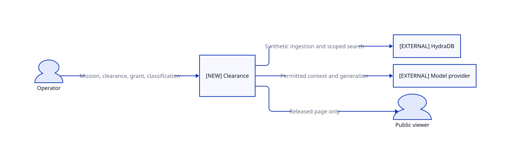

# Clearance: software delivery without crossing client boundaries

## Problem and vision

A consulting firm serves clients whose equally confidential records must not influence one another's work. A consultant may legitimately work on both engagements, but an agent already exposed to one client's information cannot be made clean by changing its permission label. Bill supplied this use case on November 14. It is an opportunity hypothesis, not production customer validation.

Why-chain: building client software requires context; context includes private rules; reused workers can carry previous-client context; changing permissions cannot erase it; the firm risks wrong software and confidential disclosure. Stop at that addressable consequence rather than a universal trust claim.

Vision: reuse the firm's expertise and tools while private context stays inside its engagement. The operator delivers useful software without inspecting every retrieved passage or granting every worker blanket access.

## Noon experiment

Fictional Northstar Advisory builds vendor-approval mini-apps for Beacon Manufacturing and Crest Industries. Both have confidential Vendor Approval Policy documents and the same task. For an invented USD 75,000 purchase, Beacon needs Procurement and CFO approvals, while Crest needs its Department Manager. Firms, figures and policies are invented to demonstrate software behavior.

A metadata-only coordinator proposes workers for both clients, with clearance bounded by server ceilings. Each worker searches its own context and requests a one-use exception for its client's Restricted threshold file. Approval never grants another client or lowers the resulting artifact's classification. The workers generate runnable apps and pass independent client-specific checks. A judge tries to attach Crest's source to Beacon's context and sees it refused. Reassigning the consultant role creates a fresh worker rather than moving the old conversation.

The three-minute video is a creative target, not an exact verified duration requirement. Noon means working software and a rehearsable capture sequence. Final capture/edit/upload follows before submission if not completed earlier. One polished core demonstration comes first; a second presentation variant is optional, not a second product.

## Authority and brain

Engagement and sensitivity are independent. Four classes: Public, Internal, Confidential and Restricted. A worker belongs to exactly one client for its lifetime. Higher clearance never changes the client. A principal authorized for both clients starts separate workers; contexts are not switched or merged.

The brain is one synthetic Markdown wiki, indexed in one HydraDB database with client-specific collection namespaces. Each file has owner, class and version labels. Workers receive admitted complete document bodies, never the whole wiki checkout. Search ranking selects document IDs; it does not forward vendor snippets or use passage-level permissions. Git branches organize development and do not separate confidential information. The approved synthetic methodology pack is copied into both client corpora; no generated content becomes shared learned memory. The metadata-only coordinator never sees client document bodies, generated apps or acceptance answers.

Artifacts retain client ownership and the highest classification of all observed inputs, including uncited sources. Client previews and downloads are scoped destinations, not public release.

## Requirements and lean acceptance

| ID | Outcome | Acceptance |
|---|---|---|
| R1 | Bind worker client and clearance at spawn. | Coordinator proposes two workers using metadata only; server rejects assignments outside its allowed clients/clearance ceiling. Model arguments cannot alter immutable authority. |
| R2 | Search real HydraDB within the assigned client. | Same query finds the appropriate policy. Admitted sources match client and clearance or exact grant. Unknown and wrong-client sources reveal no content/title to the worker. Wiki owner/class/version labels are validated before indexing. |
| R3 | Build useful client software. | Each worker generates a bounded approval workflow and a runnable amount/approval-routing app. The same USD 75,000 input gives the two expected outcomes. Standalone HTML and configuration downloads run independently of Clearance. |
| R4 | Check behavior independently. | Below/at/above-threshold cases are held apart from generation. Wrong threshold/roles fail; model confidence is not a passing check. Exported apps also work in a browser. |
| R5 | Keep artifacts in their engagement. | Outputs include all observed-input restrictions. Wrong-client delivery fails. No content-bearing manager combines both clients. |
| R6 | Reject cross-client context admission. | A visible operator-triggered attachment uses the same admission function as search. Wrong-client document is refused before model context, even at highest clearance; legitimate work continues. |
| R7 | Reassignment starts fresh. | Old run ends separately. New run gets a new ID/history, destination-client sources and approved methodology only, with no old draft, summary or continuation identifier. Late old results are ignored. |
| R8 | Make the boundary inspectable and repeatable. | Two lanes and a simple source-to-worker-to-artifact graph show actual reads, grants, generated behavior, checks and delivery. A complete run and reset/repeat do not revive old authority. |
| R9 | Remain MIT-publishable. | New implementation, invented corpus, MIT license and dependency disclosure; no proprietary designs/source, client records or credentials. |
| R10 | Allow a narrow within-client exception. | Approved read is bound to run, source/content/policy version and same client; it expires after five minutes or one use. Other worker/client, expired or reused grants fail. Read approval never declassifies output. |

R1/R2/R5-R7/R10 preserve bounded delegation; R3/R4 produce useful verified software; R8 makes intervention understandable; R9 permits hackathon use.

## Scope and cuts

Two initial workers plus a fresh replacement, one generated app type, exact same-client grants and a small recorded-source graph are in scope. Dynamic reclassification and client-only policy change/rebuild are stretch work after the core passes. No cross-client exception or approve-anyway button.

No arbitrary code execution, general tools, dynamic wiki writes, user uploads, automatic classification, semantic redaction, cross-client analytics, shared learned memory, enterprise SSO, real-client deployment, provider-isolation claim or hostile-host sandbox. Boat and Temporal were explored as optional ideas; neither is a dependency. Trusted operator can inspect both synthetic clients, but that UI is not model context. Fixed tasks avoid treating arbitrary pasted secrets as public instructions.

## Evidence and current state

The core is verified with stated coverage: a final production run repeated real HydraDB/model generation, scoped grants, independent checks and both client deliveries. Production browser app behavior, wrong-client attachment and HTML/JSON downloads were checked. Fresh reassignment, actual source edges, threshold-boundary cases and blank reset were observed in development; reassignment/reset were not repeated in the final production run. Video capture, public release and submission are still pending. The [test plan](test-plan.md) owns the exact evidence and limits.

Measure actual scoped reads/denials, grants, generation, client tests, fresh runs and delivery. Inspect constructed model inputs; absence of a secret string in final output alone is insufficient. Recorded video can use labeled time cuts, never invented completion states. No universal zero-leakage or production-security guarantee is claimed.

[Design](tech-spec.md) | [Test plan](test-plan.md) | [Build plan](build-plan.md) | [Storyboard](../../../outputs/clearance-consulting-review.md)
