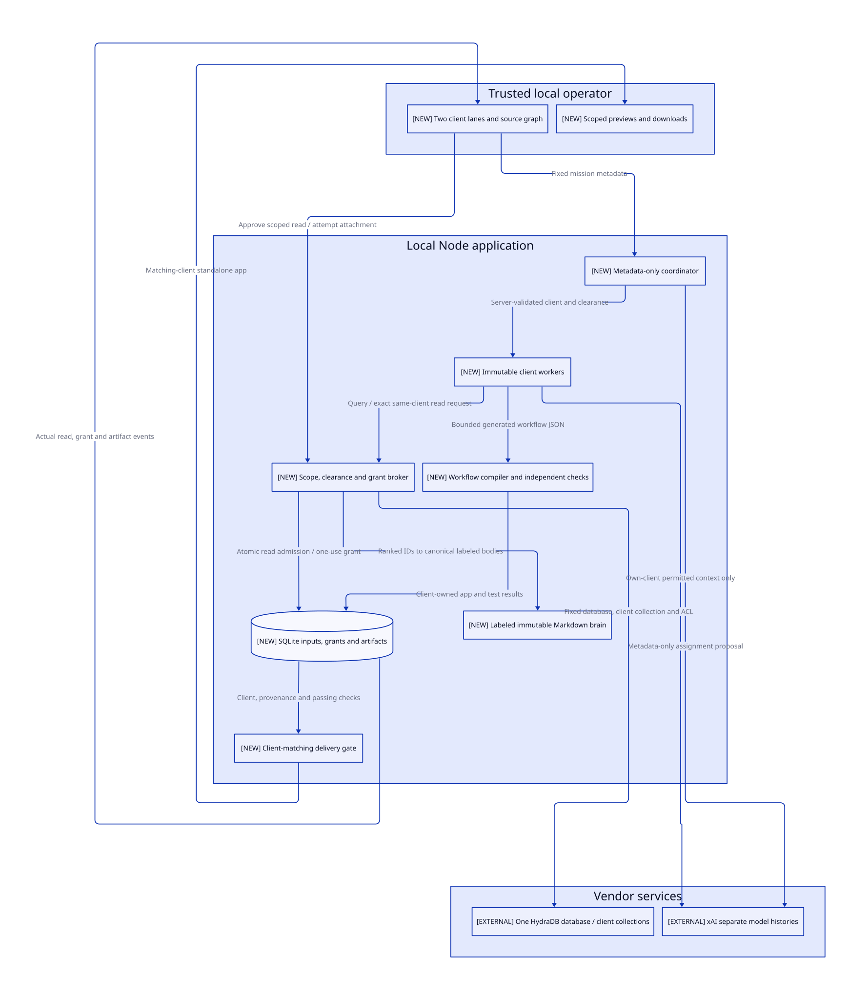

# Clearance technical design

## One page for Bill

Build one local web application where three agents use different clearances to search an invented company brain and create a landing page, sales brief and pricing recommendation. A judge changes one document's classification, watches affected pending publication stop, then watches a fresh permitted worker finish the job.

1. **Real HydraDB search, application-owned policy.** HydraDB stores and ranks synthetic documents. The server accepts ranked IDs and supplies permitted text from the same immutable fixture corpus. This avoids trusting enriched retrieval text or index freshness for authorization. It commits us to a small fixed corpus, not a general document platform.
2. **Controlled workers.** Each is a separate model context with search, scoped access request and structured artifact submission. No shell, browsing, direct database key or arbitrary code execution. This is a bounded application demonstration, not a computer sandbox.
3. **Real local publication boundary.** SQLite owns policy, observed inputs and artifacts. Permission check and publication commit are atomic. A fixed renderer turns generated structured content into a page. No external hosting or email dependency.
4. **Narrow exception and fresh recovery.** Read grant is one run, source version and use before expiry. It never authorizes disclosure. A classification change invalidates dependent work. Recovery starts a fresh Public context without old drafts/history.
5. **Independent MIT implementation.** New source and invented fixtures only. Review tracked contents and dependency licenses before making the repository public. No private source, schema, prompt, test, transcript or design document is copied into it.
6. **Low operator burden.** Default the company, story, stack, roles and UI. Ask for service access only if existing access is unavailable. Proposed application inference budget: at most 100 requests and 250,000 input / 40,000 output tokens for build/rehearsal, plus a $20 ceiling if selected-provider pricing can be verified. Proposed ceiling, not an executed transaction or verified estimate; no purchase/upgrade. Stop before exceeding the accepted budget.

One-off prototype. Policy/publication deserve clear interfaces and focused correctness checks; fixture tooling, graph layout and local UI are disposable. No production maintenance commitment. [Delivery outlook](delivery-outlook.md) owns estimates. Acceptance selects this approach; live integration still needs qualification.

## Approach and baseline

New Next.js/React/TypeScript app, one local Node process, SQLite state, HydraDB search, one tool-capable model provider. All application components are new. Exact package versions and model ID will be pinned after the initial integration check.

Verified baseline: new README/MIT repository, no application code, installed dependencies or successful service probe. Vendor documentation reviewed November 14. Credentials, model choice and latency are unresolved prerequisites, not assumed working.

Diagram legend: [NEW] identifies prototype components; [EXTERNAL] identifies existing vendor services. All depicted application components are new.

## 1. Authority and state

**1.1 Authority, a contract.** Server creates runId, missionId, clearance 0..3, allowed actions and status. Tools never accept identity, clearance, database scope or authority fields. Operator routes require a runtime random session cookie, same-origin checks and loopback binding; worker tools cannot reach them. Public route receives no operator state.

**1.2 State, a contract.** SQLite tables: documents(id, contentVersion, policyVersion, class, bodyHash, fixturePath); runs(id, missionId, clearance, status); grants(id, runId, docId, contentVersion, policyVersion, expiresAt, consumedAt); observed_inputs(runId, docId, contentVersion, policyVersion, classAtRead); artifacts(id, runId, kind, json, inheritedClass, state); publications(id, artifactId); events(id, type, runId, docId, artifactId, timestamp). Immutable authored bodies; classification updates increment policyVersion. Unknown or missing policy is denied. No distributed queue or graph service.

**1.3 Read authorization, a control.** Permit source.class <= run.clearance or an unexpired, unused grant matching run and exact source content/policy versions. In one synchronous SQLite transaction, check current run/source authority, consume any grant and insert the observed input; no await separates those operations. Stale runs cannot resume. Dispatch only after admission succeeds, with a final synchronous stale-state check immediately before initiating the model request. Existing context remains classified after grant expiry. No self-approval or reuse at a lower clearance.

## 2. HydraDB adapter

**2.1 Ingestion, a behaviour.** Twelve immutable invented documents, dedicated database/collection, stable versioned IDs, explicit ACL principals and metadata. Poll indexing status to completed. No connectors/private corpus. Local policy remains authoritative when index metadata lags.

**2.2 Search, a contract.** search(runId, query) derives scope from server state. POST /query or verified SDK equivalent: type knowledge, query_by hybrid, mode fast, graph_context false, query_apps false; fixed database/collection and nonempty server-derived ACL containing permitted class principals. No missing/empty/wildcard ACL. Empty allowed scope returns empty without querying. Metadata filters may narrow results but never own authorization.

Accept returned source IDs in ranked order only. Discard vendor text, titles, graph, summaries, extra context and raw errors. Map IDs to the immutable corpus; deduplicate preserving rank, drop unknown IDs, check current access, then return at most four canonical bodies totaling at most 12,000 characters. Each ID names the indexed content version and cannot select arbitrary paths. This is HydraDB-ranked retrieval with canonical local text. No local-search fallback. Generated content never uses raw vendor enrichment.

**2.3 Exceptional read, a behaviour.** Worker requests fixed capability pricing-input, named in its Public task. Server maps it to a restricted source; only the operator sees that source's title/content. Approval creates a five-minute, one-use grant. The resumed capability read uses the canonical mapping and control 1.3, independent of search ranking. Other workers and baseline clearance stay unchanged.

## 3. Workers

**3.1 Generation, a behaviour.** Three independent bounded loops use search_brain(query), request_access(capability), submit_artifact(kind,payload). Public mission/role prompt plus admitted context only. Six model requests maximum per attempt, 20-second search timeout, 60-second model timeout. One transient-error retry within the cap. No shared history, prior response ID, persistent provider conversation, shell, network tool or general MCP. A worker awaiting approval pauses independently.

**3.2 Inheritance, a control.** Manifest includes all inputs admitted during the run. Artifact class is at least max(classAtRead, current source classes) across the entire manifest. Model citations/classes cannot lower it. No worker-to-worker outputs in this slice. No private draft streaming to the public route.

**3.3 Concurrent change, a behaviour.** Reclassification updates policyVersion and marks dependent runs/artifacts stale in one transaction. After asynchronous search, recheck policy before input admission and model dispatch. After model response, validate the full input manifest and insert the artifact in one synchronous SQLite transaction, with no intervening await. Changed versions yield stale/ineligible output. Cancel if possible and discard stale results regardless. Unrelated runs are not invalidated by a global epoch. Earlier provider observation cannot be undone.

**3.4 Output, a contract.** landing_page: title, subtitle, features (up to six heading/body pairs), ctaLabel. brief/recommendation: title, summary, bullets (up to eight), optional recommendation. Bounded plain-text fields, schema validation, escaped React rendering. No generated HTML, JavaScript, JSX, executable code or URLs. This creates a usable page using a fixed renderer, not arbitrary software generation.

## 4. Publication and recovery

**4.1 Publication, a control.** In one synchronous SQLite transaction, verify artifact/run not stale, exact source versions unchanged, current source classes Public, inherited class Public and payload valid; then commit publication. No awaited external action between check and write. Higher-class briefs stay operator-only. A read grant never bypasses publication checks.

**4.2 Intervention, a behaviour.** Hold a real artifact before publication. Judge selects an actually contributing Public source and raises its class. Backend marks dependent work, emits events and refuses publication. Unrelated work remains eligible. The graph uses actual source-to-run-to-artifact edges, not inferred semantic relations.

**4.3 Recovery, a behaviour.** New Public run gets original public mission/role only, never old draft, history, restricted refusal detail or continuation handle. It searches again and generates from remaining permitted documents. Keep at least two independent Public product facts documents after the intervention. Old artifact stays blocked.

Already delivered output cannot be recalled. The hero demonstration is before publication. A changed policy may disable later serving, but never implies earlier recipients did not see it.

## 5. Interface and operations

**5.1 Console, a behaviour.** Mission at top; class-grouped sources left; worker cards and actual dependency graph center; artifacts right; compact event trail. Fixed graph layout, words plus colors. Controls: Run launch, Approve scoped read, Hold before publish, Reclassify, Publish, Recover, New run. Operator can inspect exactly admitted context. No workflow designer.

**5.2 Restart, a behaviour.** SQLite preserves policy/artifacts. In-flight runs become interrupted on restart, never automatically published. New run uses new IDs. Labeled synthetic-fixture reset interrupts active runs, expires pending grants and restores seed classes through monotonic policyVersion increments, never by replacing old version numbers. Preserve artifact states/history; new demonstration runs use new IDs. Reset deletes no historical files.

**5.3 Failure, a control.** Missing access/index failure prevents the real integration and shows a sanitized setup error. Retrieve credentials at runtime through the existing secret manager or secure operator mechanism; never print, commit or write credentials. No browser-exposed secret configuration. Default bind loopback. Missing HydraDB access is an explicit blocker, not permission for a local substitute.

## New file plan

Proposed new files, not current implementation:

- app/page.tsx, components/mission-console.tsx: console/graph.
- app/published/[id]/page.tsx: public artifact renderer.
- app/api/mission/route.ts, app/api/control/route.ts: operator commands.
- app/api/state/route.ts: operator polling, once per second initially.
- lib/db.ts, lib/policy.ts: schema, access/publication transactions.
- lib/hydra.ts: seed/query adapter and response normalization.
- lib/workers.ts, lib/model.ts: bounded loops and provider adapter.
- lib/artifacts.ts: output schemas and rendering contract.
- fixtures/company/*.md, fixtures/manifest.json: invented versioned corpus.
- scripts/seed.ts: ingestion/readiness.
- tests/: small ordinary-runner suite; test plan follows page acceptance.

## Alternatives and necessary mechanisms

Native ACL alone depends on unmeasured indexing and response behavior. Per-class collections complicate live reclassification/grants. Selected proposal: ranked IDs plus authoritative local policy/canonical bodies. Adds one manifest, removes dependence on enriched answer provenance. Six mechanisms: run identity, mediated retrieval, scoped grant, observed-input inheritance, atomic publication, fresh recovery. Existing state also supplies the graph; no graph database or bus.

## Sources and risks

[HydraDB API guide](https://docs.hydradb.com/llms.txt) documents source IDs/chunks, ACL omission behavior, fast retrieval and indexing lifecycle. [Software Factory work orders](https://docs.8090.ai/modules/work-orders) supports the optional build-time work-order connection. Documentation is not live qualification.

First-hour risks: access, indexing latency, class-principal matching and source attribution. Poor ranking can omit authorized sources. Provider receives permitted synthetic context; no local-only inference claim. Trusted host/operator can inspect every fixture. Hostile programs, side channels and arbitrary agents outside supplied tools are not covered. No production security certification is claimed.
